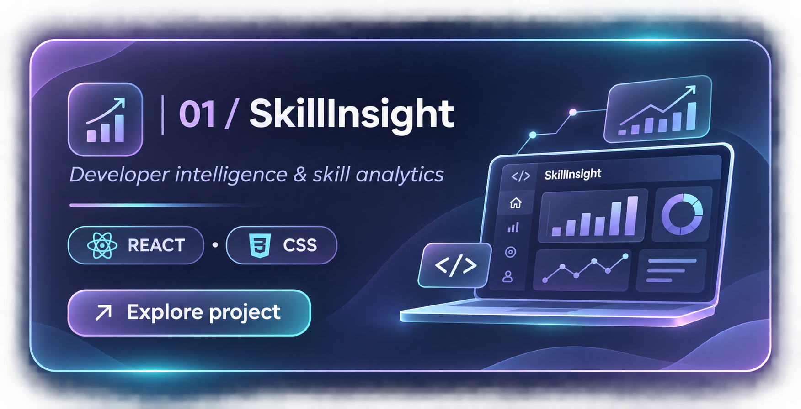
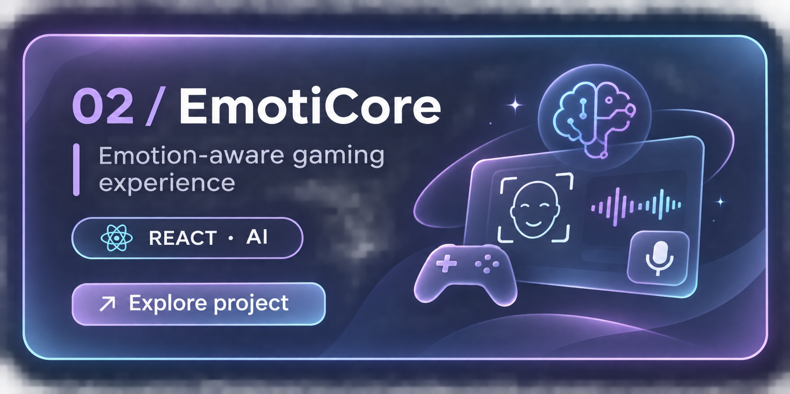
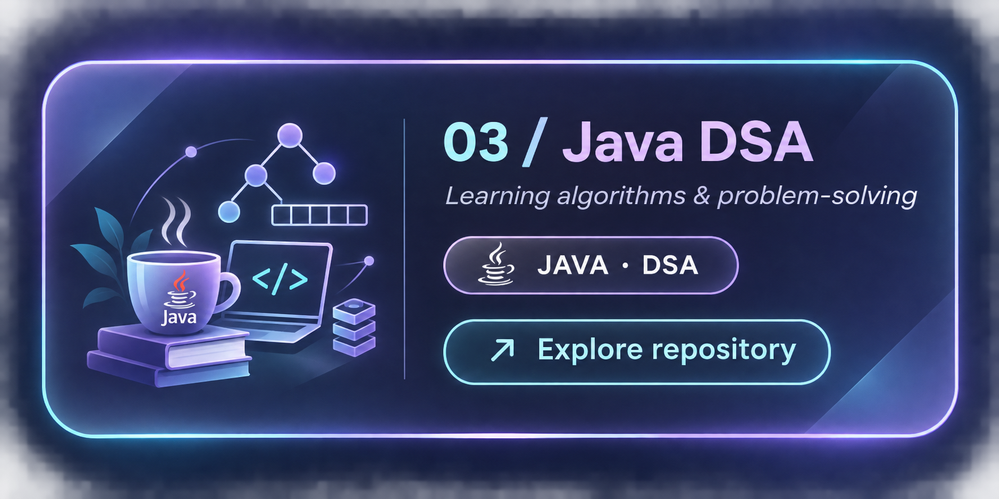
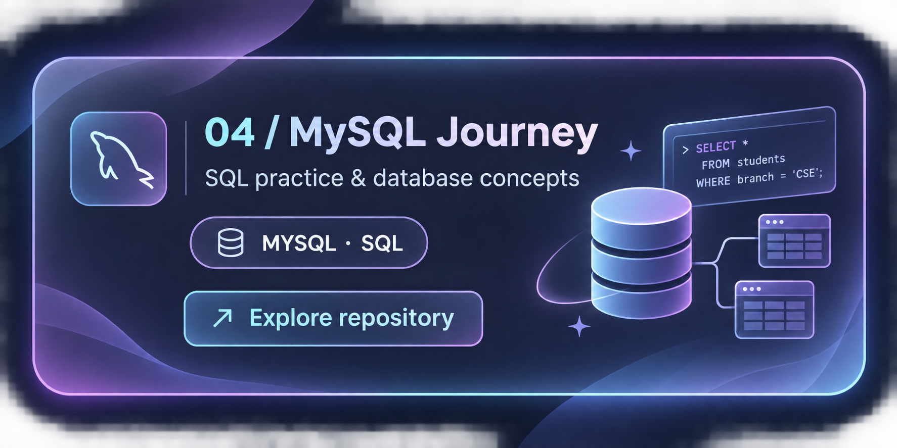

  

<h2 align="center">✦ GITHUB OVERVIEW ✦</h2>

  <i>My coding journey, one commit at a time.</i>

  
  

<h2 align="center">✦ MY TECH STACK ✦</h2>

  <i>Tools and technologies I'm exploring and building with.</i>

  

  

<h2 align="center">✦ FEATURED PROJECTS ✦</h2>

  <i>Ideas turned into code. Experiences turned into growth.</i>

<table align="center">
  <tr>
    <td width="50%" align="center">
      
    </td>
    <td width="50%" align="center">
      
    </td>
  </tr>
  <tr>
    <td width="50%" align="center">
      
    </td>
    <td width="50%" align="center">
      
    </td>
  </tr>
</table>

<h2 align="center">✦ CURRENTLY LEARNING ✦</h2>

  <i>Growing through consistency, curiosity and practice.</i>

<table align="center">
  <tr>
    <td width="33%" align="center">
      <h3>⌘ DSA</h3>
      
Building problem-solving skills and learning efficient algorithms.

        

             <code>JAVA</code> &nbsp; <code>DSA</code>
        

    </td>
    <td width="33%" align="center">
      <h3>▤ DBMS</h3>
      
Practising SQL queries, database design and data management.

         

  <code>MYSQL</code> &nbsp; <code>SQL</code>
            

    </td>
    <td width="33%" align="center">
      <h3>⌘ React</h3>
      
Building responsive interfaces and strengthening frontend concepts.

      

  <code>REACT</code> &nbsp; <code>CSS</code>

    </td>
  </tr>
</table>

<h2 align="center">✦ A LITTLE REMINDER ✦</h2>

  <i>"Small steps every day lead to big dreams."</i>
    
  <b>Keep Learning. Keep Building.</b>

<h2 align="center">✦ CONTRIBUTION ACTIVITY ✦</h2>

  <i>Every commit tells a story of progress.</i>

  

  Consistency over perfection ✦

<h2 align="center">✦ LET'S CONNECT ✦</h2>

  <i>Always open to learning, collaboration and new opportunities.</i>

  

  <b>Building. Learning. Growing.</b>

  Made with curiosity and 💜 by Rishika

