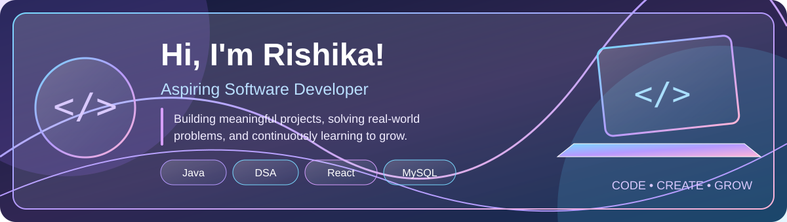

  

<h2 align="center">✦ GITHUB OVERVIEW ✦</h2>

  <i>My coding journey, one commit at a time.</i>

  
  

<h2 align="center">✦ MY TECH STACK ✦</h2>

  <i>Tools and technologies I'm exploring and building with.</i>

  

  

<h2 align="center">✦ FEATURED PROJECTS ✦</h2>

  <i>Ideas turned into code, experiments turned into experience.</i>

<table align="center">
  <tr>
    <td width="50%" valign="top">
      <h3>01 · 📊 SkillInsight</h3>
      
A Developer Intelligence Platform that analyses coding activity and tracks problem-solving growth across platforms.

      
<b>Tech Stack</b>

      

        
        
      

      <a href="https://github.com/Rishika-star/SkillInsight">↗ Explore Project</a>
    </td>
    <td width="50%" valign="top">
      <h3>02 · 💜 EmotiCore</h3>
      
An emotion-aware gaming experience exploring facial expressions and voice-based emotion analysis.

      
<b>Tech Stack</b>

      

        
        
      

      <a href="https://github.com/Rishika-star/EmotiCore">↗ Explore Project</a>
    </td>
  </tr>
  <tr>
    <td width="50%" valign="top">
      <h3>03 · ☕ Java DSA Journey</h3>
      
A hands-on learning journey covering Java fundamentals, data structures, algorithms and problem-solving.

      
<b>Tech Stack</b>

      

        
        
      

      <a href="https://github.com/Rishika-star/Java-DSA-Journey">↗ Explore Repository</a>
    </td>
    <td width="50%" valign="top">
      <h3>04 · 🗄️ MySQL DBMS Journey</h3>
      
SQL practice repository covering database operations, queries, views and database concepts.

      
<b>Tech Stack</b>

      

        
        
      

      <a href="https://github.com/Rishika-star/MySQL-DBMS-Journey">↗ Explore Repository</a>
    </td>
  </tr>
</table>

<h2 align="center">✦ CURRENTLY LEARNING ✦</h2>

  
  
  

 

<h2 align="center">✦ A LITTLE REMINDER ✦</h2>

  <i>"Small steps every day lead to big dreams."</i>
   
  <b>— Keep Learning. Keep Building. ✨</b>

  <b>Thanks for visiting my profile! 💜</b>

<h2 align="center">✦ CONTRIBUTION ACTIVITY ✦</h2>

  <i>Every commit tells a story of progress.</i>

  

  Consistency over perfection ✨

